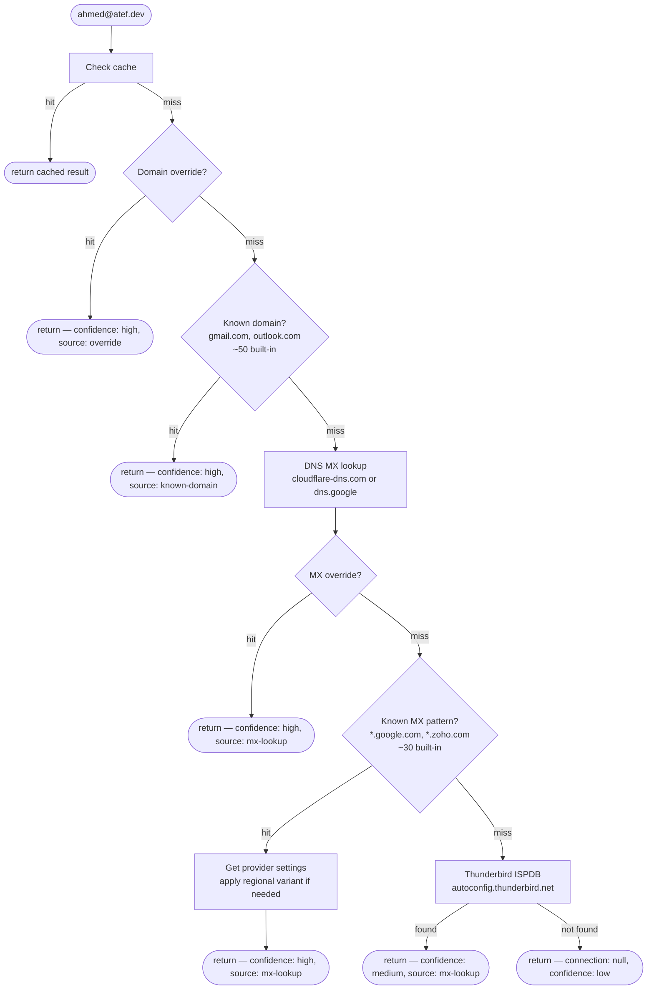

# Mailintel

Resolve email providers and IMAP/SMTP settings from any email address or domain. Zero npm dependencies.

If you're building an app where users connect their email - a CRM, helpdesk, mail client, or anything that sends/receives on their behalf - you normally have to ask them to manually enter their SMTP host, IMAP port, SSL toggle, and username. Mailintel does this automatically. Give it an email or domain and it returns everything you need to connect.

## Install

```bash
npm install mailintel
```

## API

```typescript
import { mailintel } from 'mailintel';

// With an email - username is resolved automatically
const result = await mailintel('ahmed@atef.dev');
// result.provider             => 'google'
// result.connection.imap      => { host: 'imap.gmail.com', port: 993, secure: true }
// result.connection.username  => 'ahmed@atef.dev'
// result.type                 => 'business'
// result.confidence           => 'high'

// With just a domain - same result, username stays as template
const result = await mailintel('atef.dev');
// result.connection.username  => '%EMAILADDRESS%'

// Multiple inputs at once
const results = await mailintel(['ahmed@atef.dev', 'example.com', 'user@gmail.com']);
```

<details>
<summary>Full result example</summary>

```json
{
  "email": "ahmed@atef.dev",
  "domain": "atef.dev",
  "provider": "google",
  "mx": "smtp.google.com",
  "type": "business",
  "isFree": false,
  "hasMx": true,
  "connection": {
    "imap": { "host": "imap.gmail.com", "port": 993, "secure": true },
    "smtp": { "host": "smtp.gmail.com", "port": 465, "secure": true },
    "username": "ahmed@atef.dev",
    "usernameTemplate": "%EMAILADDRESS%"
  },
  "confidence": "high",
  "source": "mx-lookup",
  "raw": {
    "mx": [{ "priority": 1, "exchange": "smtp.google.com" }],
    "dns": { "Status": 0, "Answer": [{ "name": "atef.dev", "type": 15, "TTL": 300, "data": "1 smtp.google.com." }] },
    "ispdb": null
  }
}
```

The API and CLI return the same structure. The CLI's `--json` flag outputs this exact format.

</details>

### Factory

Use `createMailintel()` for reusable config, custom overrides, or a shared cache:

```typescript
import { createMailintel } from 'mailintel';

const lookup = createMailintel({
  timeout: 3000,
  providers: {
    'megacorp.io': {
      provider: 'internal',
      imap: { host: 'imap.megacorp.io', port: 993, secure: true },
      smtp: { host: 'smtp.megacorp.io', port: 465, secure: true },
    },
  },
});

await lookup('admin@megacorp.io');  // uses override, no network call
lookup.clearCache();
```

### Options

| Option | Type | Default | Description |
|--------|------|---------|-------------|
| `timeout` | `number` | `5000` | Network request timeout (ms) |
| `cache` | `boolean` | `true` | In-memory domain caching |
| `cacheTtl` | `number` | `1800000` | Cache TTL in ms (30 min) |
| `mxLookup` | `boolean \| 'cloudflare' \| 'google'` | `true` | `true` or `'cloudflare'` = Cloudflare DNS, `'google'` = Google DNS, `false` = disabled |
| `ispdb` | `boolean` | `true` | Thunderbird ISPDB fallback |
| `fetch` | `typeof fetch` | `globalThis.fetch` | Custom fetch (useful for proxies or testing) |
| `providers` | `Record<string, ProviderOverride>` | - | Domain-to-provider overrides |
| `mxOverrides` | `Record<string, ProviderOverride>` | - | MX suffix-to-provider overrides |

## CLI

```bash
npx mailintel ahmed@atef.dev
```

```
ahmed@atef.dev

  provider      google
  domain        atef.dev
  type          business
  confidence    high
  mx            smtp.google.com
  source        mx-lookup

  IMAP  imap.gmail.com:993  SSL
  SMTP  smtp.gmail.com:465  SSL
  Username  ahmed@atef.dev
```

Supports multiple emails, domain-only lookups, and JSON output:

```bash
mailintel user@gmail.com admin@example.com    # multiple emails
mailintel atef.dev                            # domain-only lookup
mailintel ahmed@atef.dev --json               # machine-readable JSON
```

### CLI options

| Flag | Description |
|------|-------------|
| `--json` | Output raw JSON |
| `--timeout <ms>` | Network timeout (default: 5000) |
| `--resolver <name>` | DNS resolver: `cloudflare` (default) or `google` |
| `--no-cache` | Disable caching |
| `--no-ispdb` | Skip Thunderbird ISPDB fallback |
| `-h, --help` | Show help |
| `-v, --version` | Show version |

## How it works



At most 2 HTTP requests per uncached lookup - one DNS query and one ISPDB fetch. Known domains resolve instantly with zero network calls.

### How it gets the data

Every email domain has **MX records** in DNS that say which mail server handles its email. `atef.dev` points to `smtp.google.com` (Google Workspace), another domain might point to `mx.zoho.com` (Zoho).

Mailintel queries these using **DNS-over-HTTPS** - plain HTTPS requests to public DNS resolvers, not system-level DNS calls. Works in serverless functions, edge runtimes, and anywhere `fetch` is available. No native modules, no UDP sockets, no special permissions.

| Service | URL | What it returns |
|---------|-----|-----------------|
| **Cloudflare DNS** (default) | `cloudflare-dns.com/dns-query?name=atef.dev&type=MX` * | MX records - which mail server handles the domain |
| **Google DNS** (alternative) | `dns.google/resolve?name=atef.dev&type=MX` | Same MX records, different resolver |
| **Thunderbird ISPDB** (fallback) | `autoconfig.thunderbird.net/v1.1/{domain}` | IMAP/SMTP settings from Mozilla's open database |

\* Requires an `Accept: application/dns-json` header. Opening this URL in a browser returns an HTML page, not JSON. Mailintel sets this header automatically.

**Rate limits**: Cloudflare DNS has no published limits and is free ([docs](https://developers.cloudflare.com/1.1.1.1/encryption/dns-over-https/make-api-requests/dns-json/)). Google DNS has undisclosed limits and returns HTTP 429 when exceeded ([docs](https://developers.google.com/speed/public-dns/docs/doh)). Thunderbird ISPDB is a static file server with no published limits. The built-in cache means you'll rarely hit any of these more than once per domain.

Once the MX server is known, it's matched against ~30 provider patterns. For well-known free domains like `gmail.com`, the network is skipped entirely - settings come from a built-in map of [~50 known domains](src/data/domains.ts).

## Result type

```typescript
interface MailintelResult {
  email: string;                 // input email, or '' for domain-only lookups
  domain: string;
  provider: string | null;       // 'google', 'microsoft', 'zoho', etc.
  mx: string | null;             // primary MX hostname
  type: 'free' | 'business' | 'unknown';
  isFree: boolean;
  hasMx: boolean;
  connection: {                  // null when settings can't be determined
    imap: { host: string; port: number; secure: boolean };
    smtp: { host: string; port: number; secure: boolean };
    username: string;            // resolved: 'ahmed@atef.dev'
    usernameTemplate: string;    // raw template: '%EMAILADDRESS%'
  } | null;
  confidence: 'high' | 'medium' | 'low';
  source: 'override' | 'known-domain' | 'mx-lookup' | null;
  raw: { mx, dns, ispdb };      // raw data for debugging
}
```

### Username

`username` is the resolved value you pass directly to the mail server. When the input is a domain (no email), it stays as the raw template since there's no email to resolve.

`usernameTemplate` is the raw template, useful if you're building a config UI. Templates follow the [Thunderbird ISPDB convention](https://wiki.mozilla.org/Thunderbird:Autoconfiguration:ConfigFileFormat):

| Template | Resolves to | Used by |
|----------|------------|---------|
| `%EMAILADDRESS%` | `ahmed@atef.dev` | Nearly all modern providers |
| `%EMAILLOCALPART%` | `ahmed` | Some older/self-hosted setups |
| `%EMAILDOMAIN%` | `atef.dev` | Rare |

All built-in providers use `%EMAILADDRESS%`. The ISPDB fallback may return any of the three depending on what Thunderbird's database has for that provider.

## Supported providers

Google, Microsoft, Yahoo, Zoho (with EU/IN/AU/JP regional variants), iCloud, Fastmail, ProtonMail, GoDaddy, Titan, OVH, IONOS, Hostinger, Yandex, AOL, Rackspace, DreamHost - plus any provider discoverable via MX records or Thunderbird ISPDB.

## Contributing

Missing a provider or found incorrect settings? [Open an issue](https://github.com/AhmedAtef07/mailintel/issues) or submit a PR.

## License

MIT
